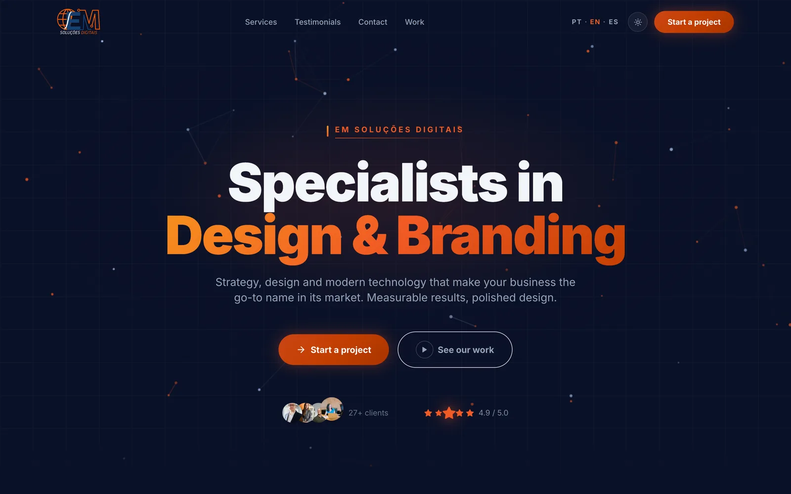
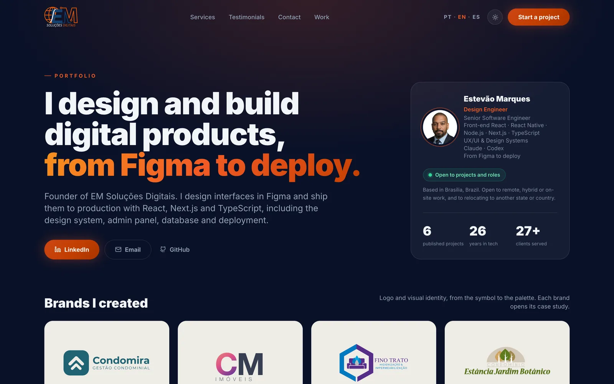

# EM Soluções Digitais: studio site, portfolio and CMS

The website of my design & development studio, and my personal portfolio. It is a Next.js app with its own
admin panel: every case study, service, testimonial and SEO field on the public site is edited there, stored in
PostgreSQL and published in three languages.

**Live:** [emsolucoesdigitais.com.br/en](https://emsolucoesdigitais.com.br/en) · [case studies](https://emsolucoesdigitais.com.br/en/cases)





## Stack

Next.js 14 (pages router) · React 18 · TypeScript · Tailwind CSS · Framer Motion · Prisma · PostgreSQL (Neon) ·
NextAuth (Google) · Vercel Blob · Nodemailer · `next/og` on the Edge runtime · Storybook 10 + Vitest · Vercel

## Highlights

- **Static pages that update the moment the admin saves.** Public pages use ISR (10-minute safety net). Saving in the
  admin calls `revalidatePublic`, and data scripts call a token-protected `/api/revalidate` (constant-time secret
  check, allow-list of public paths); both regenerate the page in every locale at once. See
  [`src/lib/revalidate.ts`](src/lib/revalidate.ts) and [`src/pages/api/revalidate.ts`](src/pages/api/revalidate.ts).
- **Portuguese, English and Spanish.** Native Next.js i18n with no browser-language redirects; a `PT · EN · ES`
  switcher stores the choice in a cookie read by the middleware. UI strings live in typed dictionaries, database
  content in a per-row `i18n` JSON column with field-level fallback to Portuguese. `hreflang`, canonical,
  `og:locale` and the sitemap cover every version. Details in [`docs/i18n.md`](docs/i18n.md).
- **Interactive service "scenes" in CSS and SVG, not screenshots.** A before/after slider (`role="slider"`, arrow
  keys), a magnetic button, color modes that re-theme a mock screen, a runnable mini app. All work with mouse,
  keyboard and touch, and replaced ~200 KB of images. See
  [`src/components/services`](src/components/services).
- **Accessibility and performance as a gate.** Lighthouse accessibility 100 on the home page, the case list and every
  case study; desktop performance 100 (local lab runs). CMS images go through `next/image` when their host
  can be optimized ([`CmsImage`](src/components/CmsImage.tsx)), fonts are subset, and the dynamic Open Graph images are rendered at the edge with bundled fonts
  ([`src/pages/api/og.tsx`](src/pages/api/og.tsx)).
- **A small headless CMS of its own.** Case studies are structured JSON (summary, deliverables, Figma showcase,
  brand identity, stack notes) rendered by one layout ([`CaseStudyLayout`](src/components/case/CaseStudyLayout.tsx)).
  The admin also has a lead CRM: contact-form leads arrive tagged with their language and can be answered from it.

## Run it locally

Requires Node 20+ and a PostgreSQL database.

```bash
npm install            # also runs prisma generate
cp .env.example .env   # fill in DATABASE_URL and, for the admin, the Google OAuth keys
npx prisma db push     # create the tables
npm run seed           # optional sample content
npm run dev            # http://localhost:3000 (and /en, /es)
```

Other scripts: `npm run storybook` (component library on :6006), `npm run build`, `npm run lint`.

## Project layout

```
src/pages         public pages (/, /cases, /cases/[slug]), admin and API routes
src/components    UI, case-study template, service scenes
src/lib           i18n, localization of DB rows, SEO, revalidation, uploads
src/locales       pt-BR (source of truth), en, es
prisma            schema, seeds, translation scripts, revalidation helper
tools/capas       headless-Chrome capture used to build the case covers
```

The Figma ↔ code tooling I use for the case studies lives in its own repository:
[figma-design-engineering-toolkit](https://github.com/vaotees/figma-design-engineering-toolkit).

## License

All rights reserved. Shared for portfolio review only; see [LICENSE](LICENSE). Client names, logos and case texts
belong to their owners and appear here as they do on the public site.
